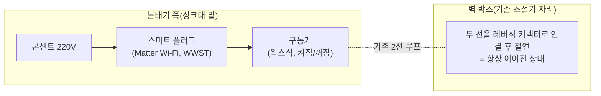
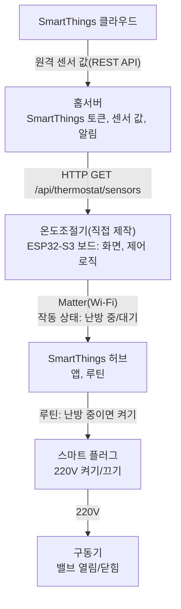
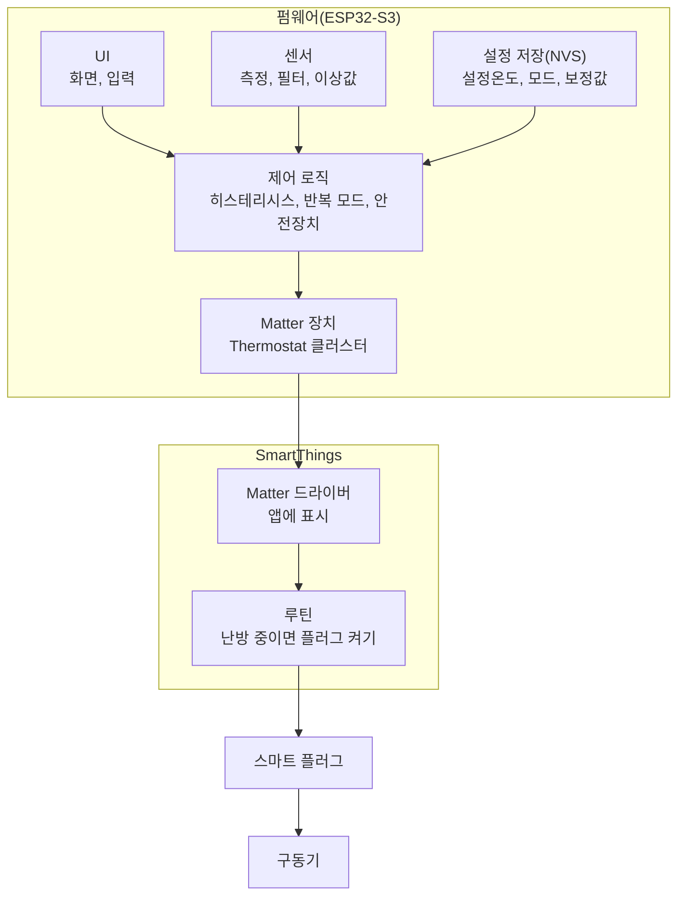

# 2026-11-24 — 설계: 우리 집 난방을 SmartThings로 (Claude 앱 대화)

## 이 노트에 대해

- **출처:** 2026-11-24 Claude 앱(채팅)에서 나눈 설계 대화 원문. 사용자가 그 원문을 Claude Code에 붙여 넣었고, 이 노트는 그것을 바탕으로 썼다.
- **시각:** 채팅 원문에 시각이 남아 있지 않다. 그래서 시각 대신 대화 순서대로 번호를 붙였다. 괄호 안의 "원문 N장"은 붙여 넣은 원문의 장 번호다.
- **따옴표:** 사용자 발언은 원문 그대로 옮겼고, 오타도 고치지 않았다. 다만 사는 곳이나 집 기기를 드러내는 말은 `[대괄호]`로 가렸다. ESP32 보드와 부품 정보는 독자가 따라 할 수 있게 구체적으로 남겼다. Claude의 답은 요약했다.
- **관점:** 이 책은 **IoT를 해 보려고 임베디드에 입문한 웹 개발자의 토이 프로젝트 개발기**다. 이 사이트의 앞선 책 『웹 개발자를 위한 임베디드 입문』과 『웹 개발자의 ESP32 도전기』 다음에 오는 이야기이고, 도전기에서 쓴 보드(Waveshare ESP32-S3-Touch-LCD-4.3B, 2026-11-23 도착)를 그대로 쓴다.
- **표기:** 각 절 끝의 `질문 노트`, `감탄 노트`, `웹 개발자 시선`, `교훈`, `책 소재`는 나중에 책으로 다시 쓸 때 쓰는 재료다. `웹 개발자 시선`은 대화에 나온 말이 아니라 **책을 쓸 때 붙일 비유 후보**다.
- **근거 표기:** 다른 책과 같다. `실측`(직접 보거나 잼), `문헌 기반`(문서·커뮤니티에서 가져옴), `추정`, `확인 필요`. 이날은 **실측이 하나도 없다.** 모든 하드웨어 사실은 사용자의 기억이거나 문헌이다.

---

## 1. 채팅이냐 코드냐 (원문 1장)

- 사용자: "새로운 프로젝트 구상이 떠올랐어 코딩해야할것 도있는데 채팅이 나을까 아님 코드에서 말하는게 나을까?"
- Claude의 답: 구상(아이디어, 범위, 부품 선택, 큰 구조)은 채팅이 가볍고, 파일 여러 개를 만들고 빌드·테스트하는 실제 개발은 Claude Code가 낫다. 구상이 끝나면 요약본을 만들어 Claude Code로 넘기라고 했다.
- 사용자: "아하 넘길수있구나"
- 대화는 자동으로 이어지지 않으니, 요약본을 첫 메시지에 붙이거나 `CLAUDE.md`로 넣으면 된다는 설명을 들었다.

> 책 소재: 이 책의 출발점. 설계는 채팅에서, 구현은 Claude Code에서. 그리고 이 노트 자체가 그 "넘기기"의 결과물이다. 실제로는 요약본이 아니라 **대화 원문 전체**를 넘겼다(16절).

> 웹 개발자 시선: 기획 회의와 개발 착수의 분리. 회의록(채팅 원문)을 티켓 저장소(레포)로 옮기는 순간이 프로젝트의 시작이다.

---

## 2. 아이디어: SmartThings용 네스트 (원문 2장)

- 사용자: "구글 네스트 온도조절기 처럼 삼성 스마트싱스 생태계에 있는 온도조절기를 만들어볼까해."
- Claude의 답:
  - 가장 현실적인 길은 **Matter**다. Arduino ESP32 코어에 Matter 온도조절기 예제가 있다(`문헌 기반`, Espressif 문서).
  - ESP32와 Matter로 만든 DIY 온도조절기 OpenCalido가 M5Dial용으로 시작했다(`문헌 기반`). 네스트 같은 원형 다이얼 느낌을 낼 수 있다.
  - SmartThings 허브가 필요하다. SmartThings의 Matter 온도조절기 지원은 들쭉날쭉해서, 기성품 tado°도 온도 센서로만 잡힌 사례가 있다(`문헌 기반`, 커뮤니티 글). 연결 테스트부터 하라고 했다.
  - 네스트는 미국식 HVAC 기준이라, 한국 집에서는 **무엇을 제어할지**부터 정해야 한다고 되물었다.

> 질문 노트 후보: "네스트처럼 만들 수 있을까?" → Matter로 만들면 직접 만든 기기도 SmartThings에 정식 기기처럼 붙는다. 단, 온도조절기 지원은 직접 확인해야 한다.

> 웹 개발자 시선: Matter는 스마트홈의 공개 API 규격이다. 규격을 지키면 내가 만든 서버(기기)도 남의 클라이언트(SmartThings 앱)에 붙는다. 다만 클라이언트가 규격의 어디까지 구현했는지는 따로 확인해야 한다. 브라우저 호환성 표를 보는 것과 같다.

---

## 3. 우리 집 난방 구조 파악하기 (원문 3장)

이 절은 대화가 가장 많이 오간 부분이다. **사용자가 기억을 하나씩 꺼낼 때마다 배선도가 바뀌었다.**

### 3.1 지역난방이라 보일러가 없다

- 사용자: "우리집은 전형적인 아파트 환경이고, 지역난방 시스템이야"
- Claude의 답: 보일러가 없으니 DIY하기 좋은 구조다. 보통 방 조절기 → 분배기 옆 메인 제어기 → 방별 밸브 구동기로 이어지고, 요즘 아파트는 월패드와 RS-485로 묶인다. 접근법 셋을 내놨다.
  1. 월패드·제어기 통신(RS-485)에 끼어들기(추천)
  2. 밸브 구동기를 릴레이로 직접 제어(220V라 비추천)
  3. 기존 조절기 버튼을 물리적으로 누르기

> 책 소재: 사용자는 처음에 "보일러 온도 조절기"라고 불렀지만(Claude Code 요청문), 실제로 집에는 **보일러가 없다.** 지역난방이다. 제목이나 서문에서 이 오해를 짚고 시작하면 좋다.

### 3.2 월패드가 아니라 220V

- 사용자: "아쉽게도 우리집은 월패드 방식이 아니라, 구동기의 220v가 컨트롤러까지 오는 방식이야."
- Claude의 답: 그러면 방 조절기는 사실상 **220V 스위치**다. 핵심은 "220V를 누가 다루느냐"가 된다.
  - 방법 A: 벽 조절기를 통째로 직접 만든 회로로 교체 → 비추천(절연, 발열, 화재)
  - 방법 B: **220V는 인증 제품(스마트 릴레이)에, 두뇌는 직접 제작**(추천). 직접 만드는 쪽은 전부 USB 전원이라 안전하다.
  - 제어 로직 팁: 구동기는 켜짐/꺼짐뿐이고 몇 분에 걸쳐 열린다. 히스테리시스(설정온도 ±0.5℃)와 최소 동작 시간을 둬야 한다.

> 웹 개발자 시선: "220V는 인증 제품에" = "암호화는 직접 짜지 말고 검증된 라이브러리를 쓴다". 위험한 층은 남이 인증받은 것에 맡기고, 내가 짜는 코드는 안전한 층에만 둔다.

> 웹 개발자 시선: 히스테리시스와 최소 동작 시간은 디바운스와 레이트 리밋이다. 값이 경계에서 떨릴 때 매번 반응하면 릴레이가 깜빡인다.

### 3.3 조절기는 하나, 집 전체가 한 구역

- 사용자: "온도조절기는 한군데만 있어"
- Claude의 답: 릴레이 1개, 제어 로직 1개면 된다. 센서 위치가 곧 집 전체 기준이 되니, 오히려 네스트보다 잘 만들 수 있는 부분이 생긴다(여러 방 센서 평균, 시간대별 기준 방 바꾸기, 외출 모드).
- 5단계 계획을 들었다: ① UI와 온도 표시(220V 없이) ② Matter 등록 테스트 ③ 제어 로직 ④ 릴레이 설치 ⑤ 스마트 기능.

### 3.4 구축 아파트에선 흔한가

- 사용자: "근데 저 방식이 구축아파트에는 흔히 있는 방식맞지? [지역 생략] 아파트거든"
- Claude의 답: 흔하다. 오래된 지역난방 아파트는 방별 제어나 월패드 연동이 없는 경우가 많다. 다만 세대마다 다를 수 있다(24V 구동기, 별도 제어함, NO/NC 타입). 구동기 라벨 사진만 찍으면 차단기를 내릴 필요도 없다고 했다.

### 3.5 사용자가 그린 배선도, Claude가 고친 한 줄

- 사용자: "그럼 전반적인 구조가.

  조절기 쪽에서 지금 컨트롤러로 가는 선을 뽑아서,
  조절기-릴레이간 연결을 하고,

  지금 깔린 배선으로 릴레이-컨트롤러를 연결한다.

  이 배선도 맞지?"
- Claude의 답: 거의 맞지만 **직접 만드는 다이얼과 릴레이 사이에는 선이 없다.** 둘은 무선(SmartThings/Zigbee/Matter)으로 이어진다. 바뀌는 배선은 벽 박스 안뿐이다. 기존 조절기를 비상용으로 남기려면 직렬이 아니라 **병렬**로 이어야 하고, 스마트 릴레이는 대부분 중성선(N)이 필요하다는 점도 짚었다.

> 질문 노트 후보: "이 배선도 맞지?" → 두뇌(다이얼)와 손(릴레이)은 선이 아니라 네트워크로 잇는다.

> 웹 개발자 시선: 웹 개발자는 "A가 B를 제어한다"를 들으면 자연스럽게 API 호출(네트워크)을 떠올리는데, 하드웨어 얘기가 나오자 오히려 선으로 이으려고 했다. 책에서 솔직하게 쓸 만한 장면이다.

### 3.6 조절기는 떼어 버릴까

- 사용자: "기존 조절기는 뜯어버릴까 했는데?"
- Claude의 답: 괜찮다. 대신 기존 조절기가 하던 **안전장치 역할**을 새 시스템이 넘겨받아야 한다.
  - 기존 조절기는 버리지 말고 보관, 선 위치는 사진으로 남기기
  - 수동 조작 수단(물리 버튼 있는 릴레이)
  - 페일세이프: 센서 이상값이면 끄기, 연결이 끊기면 계속 켜져 있지 않게(최대 가동 시간), 최저온도 보호(예: 10℃)

> 웹 개발자 시선: 레거시 시스템을 걷어낼 때, 그 시스템이 "문서에 없이" 해 주던 일(타임아웃, 기본값)을 먼저 목록으로 만드는 것과 같다.

### 3.7 전원은 구동기 쪽에서 온다

- 사용자: "좋아 그리고 하나 더 배선도에서 고칠게 있는데.
  일단 내 기억에 선이 2개였고, 전원이 조절기를 타고 구동기로 가는게 아니라, 구동기 쪽에 전원이 들어가고 그게 조절기로 오는 형태였어"
- Claude의 답: 그러면 벽 조절기는 전원이 필요 없는 **스위치**이고, 벽 박스에는 **중성선이 없다.** 일반 스마트 릴레이는 벽 박스에 못 넣는다. 무중성선 스위치는 꺼져 있을 때도 미세 전류를 흘려서 구동기가 살짝 데워질 수 있다. 그래서 **릴레이를 분배기 쪽에 다는 안**을 1순위로 올렸다.

```text
[분배기 쪽]  220V 전원 ─┬─ 구동기
                        │     │
                     선 1   선 2
                        │     │
[벽 박스]            └ 조절기 ┘  ← 두 선을 붙였다 뗐다 하는 스위치
```

- 사용자: "아 저게 중성선이 없는 전형적인 구성이야?"
- Claude의 답: 옛날 전등 스위치와 같은 원리다. L선만 끊었다 이었다 한다. 조절기 전원은 보통 건전지로 해결한다.

### 3.8 건전지도, 제어함도 없다

- 사용자: "조절기에 건전지는 없던데"
- Claude의 답: 기계식(바이메탈)이면 전원이 필요 없고, 디지털이면 220V에서 미세 전류를 빌려 쓰거나, 분배기 쪽 제어함이 저전압 신호선만 보내는 구조일 수 있다.
- 사용자: "제어함은 없어"
- 사용자: "화면은 없었는데 있는걸로 바꿨거든. 그때도 건전지는 안 달았어"
- Claude의 답: 그렇다면 지금의 디지털 조절기는 **220V 회로에서 전기를 조금씩 빌려 쓰는 방식**이다(`추정`: 화면이 있는데 건전지도 N선도 없으니 다른 방법이 없다는 추론). 좋은 소식도 있다. 지금 조절기가 잘 돈다는 건 **구동기가 미세 누설 전류를 견딘다**는 뜻이다(`추정`).

> 감탄 노트 후보: 건전지가 없다는 사실 하나로 조절기의 동작 방식을 거꾸로 추리해 냈다. 디버깅에서 "이게 없으니 저건 불가능하다"로 후보를 지우는 방식과 같다.

> 책 소재: 사용자는 예전에 기계식 조절기를 디지털로 **직접 교체한 경험이 있다.** 웹 개발자가 이미 220V 벽 박스를 한 번 열어 본 셈이다. 서문의 필자 소개에 넣을 만하다.

### 3.9 구동기 전원: 직결인가 콘센트인가

- 사용자: "구동기에 220v가 바로 들어가던데?"
- Claude의 답: 플러그가 아니니 선택지는 둘이다.
  - **A안:** 벽 박스에 무중성선 스마트 릴레이. 예전 조절기 교체와 같은 작업이다. 관건은 **최소 부하**(무중성선 제품은 몇 W 이상 부하가 필요한데 구동기는 2~3W 수준인 경우가 많다, `문헌 기반`/`확인 필요`).
  - **B안:** 분배기 쪽 L/N에 일반 스마트 릴레이. 가장 안정적이지만 직결선을 자르고 잇는 작업이라 전기기사 권장.
  - 어느 쪽이든 다이얼 코드는 같다. 릴레이가 SmartThings에 "스위치"로 잡히기만 하면 된다.

> 웹 개발자 시선: "어느 쪽이든 다이얼 코드는 같다"는 인터페이스 뒤의 구현 교체다. 다이얼은 `switch.on()`만 알고, 그 스위치가 벽 박스에 있든 분배기에 있든 상관없다.

> 확인 필요: 이 발언과 7절의 "지금도 아마 콘센트로 꼽혀있던걸로 봤어"는 **서로 어긋난다.** 둘 다 사용자의 기억이다. 실물을 보고 확정해야 한다(아래 "확인할 것" 1번).

> 교훈: 집 배선은 기억으로 설계하면 대화할 때마다 바뀐다. 이날 배선도는 네 번 바뀌었다(통신선 → 220V 공급 → 구동기 쪽 전원 → 콘센트). 다음에는 사진부터 찍고 시작한다.

---

## 4. 배선도와 구성도 (원문 4장)

- 사용자: "그럼 최종 배선도와 구성도 보여줘"
- A안 배선도와 시스템 구성도를 받았다(원문에서는 그림). 이 노트에서는 7절의 최종 결정(스마트 플러그) 기준으로 다시 그렸다.





### 4.1 왁스 구동기는 0 아니면 100

- 사용자: "그리고 왁스 방식 구동기는 아날로그야? 아님 100퍼 개방 0퍼 폐쇄 만 돼?"
- Claude의 답: 사실상 **0% 아니면 100%**다(`문헌 기반`). 전원이 들어오면 왁스가 데워져 팽창하며 몇 분에 걸쳐 끝까지 열리고, 끊기면 식으면서 스프링이 닫는다. 중간에 멈추게 만든 부품이 아니다.
- 대신 **시간 비례 제어**로 아날로그처럼 쓸 수 있다. 20분 주기 중 몇 분을 켤지 조절해 평균 열량을 바꾼다. 바닥난방은 반응이 느려 히스테리시스보다 고르게 유지된다. 1단계는 히스테리시스, 나중에 시간 비례 제어로 업그레이드하자는 제안을 들었다.
- 구성도에서 실제로 플러그를 켜는 주체는 **허브의 루틴**이다. 허브가 멈추면 난방도 멈춘다는 점도 이때 짚었다.

> 질문 노트 후보: "왁스 구동기는 아날로그야?" → 켜짐/꺼짐뿐. 아날로그는 시간으로 흉내 낸다.

> 웹 개발자 시선: 시간 비례 제어는 PWM이고, 웹으로 치면 "1분에 N번만 보내기" 같은 듀티 사이클 스로틀링이다. 켜짐/꺼짐만 되는 출력으로 평균값을 만든다.

### 4.2 릴레이 고르는 기준, 그리고 A안도 220V다

- 사용자: "스마트 릴레이 고르는 기준을 정리해줘"
- 우선순위: 무중성선 지원(A안) → 최소 부하 ≤ 구동기 소비전력 → KC 인증 → SmartThings 호환. 통신은 Zigbee(로컬) 또는 Matter, Wi-Fi 클라우드 연동은 비추천. 페일세이프로 정전 후 복구 동작, 자동 꺼짐 타이머, 물리 버튼.
- 사용자: "B안도 보여줄래?"
- B안: 분배기 쪽에서 220V(L, N) → 릴레이(N 사용) → 구동기. 벽 박스 두 선은 절연. 습기 때문에 정션박스에 넣고 배관보다 높게, 수납장 안은 Zigbee 신호가 약할 수 있다.
- 사용자: "근데 A안도 220v를 다뤄야하는건 똑같지 않아?"
- Claude의 답: 맞다. 둘 다 220V 작업이다. "직접 할 수 있는 범위"라고 한 건 위험이 없다는 뜻이 아니라 **작업 난이도**(같은 선을 옮겨 꽂는 교체 vs 자르고 새로 잇기)의 차이였다고 정정했다. 공통 수칙: 차단기를 내린 뒤 **검전기로 정말 끊겼는지 확인**, 단자에 끝까지 넣고 당겨 보기.
- 사용자: "B도 빼고 연결한다는 점에서 비슷해보여서"
- Claude의 답: 분배기 쪽에 단자대나 커넥터가 이미 있다면 B안도 "빼서 다시 꽂기"다. 차이는 N선 하나 더 따오기와 케이스 고정뿐. 그렇다면 최소 부하 걱정이 없는 B안이 오히려 낫다.

> 책 소재: 사용자가 AI의 표현("직접 할 수 있는 범위")을 두 번 연속 되물어 정확한 의미를 끌어낸 장면. AI 설명을 그대로 받지 않고 "그게 정말 다른가"를 묻는 태도.

> 교훈: "안전하다"와 "쉽다"를 구분한다. 220V 작업은 쉬워도 안전한 작업이 아니다.

---

## 5. 컴포넌트 설계와 Matter (원문 5장)

### 5.1 판단은 다이얼이, SmartThings는 전달만

- 사용자: "좋아 그럼 하드웨어는 이정도로 될거같고.
  소프트웨어 쪽 볼까.?

  그전에 각 컴포넌트 관점의 설계도 보여줘"
- 설계 원칙: 다이얼이 온도를 재고 "지금 난방이 필요한지"를 스스로 판단해 Matter 온도조절기의 **작동 상태(난방 중/대기)**로 알린다. SmartThings 루틴은 그 상태에 따라 플러그를 켜고 끄기만 한다. 핵심 로직이 전부 펌웨어 안에 있어서 테스트하기 쉽다.



- 먼저 검증할 위험: SmartThings 루틴에서 Matter 온도조절기의 **작동 상태를 조건으로 쓸 수 있는지**(`확인 필요`). 안 되면 "난방 요청"용 보조 엔드포인트(켜짐/꺼짐 센서)를 하나 더 만든다.

> 웹 개발자 시선: 비즈니스 로직은 서버(펌웨어)에, 워크플로 엔진(루틴)은 "상태가 바뀌면 이걸 호출"만 한다. 로직이 노코드 도구 안에 흩어지면 테스트할 방법이 없다.

### 5.2 목표온도와 "1시간 중 N분"

- 사용자: "목표온도랑 스케줄(1시간중 몇분 구동할지 설정)
  이걸 메터 기기에서 설정가능할까?"
- Claude의 답: 목표온도는 표준(난방 설정온도)에 있어서 앱에서 바로 된다. **"1시간 중 N분"은 Matter 표준에 없다.** 한국 조절기의 예약(반복) 모드다. 방법 셋:
  1. 다이얼 메뉴에서 설정(추천)
  2. 0~100% 슬라이더 보조 엔드포인트(밝기 조절 장치)로 앱에 노출. 앱에서는 조명처럼 보이는 꼼수
  3. SmartThings Edge 드라이버를 직접 작성(Lua, 난이도 높음)
- 모드 구조 제안: **온도 모드**(목표온도 자동) / **반복 모드**(온도와 무관하게 60분 중 N분) / 꺼짐.

### 5.3 표준에 있는 것, 앱에 보이는 것

- 사용자: "온도조절기 표준에는 어떤 설정들이있어?"
- 기본: 현재 온도, 난방/냉방 설정온도, 운전 모드, 작동 상태(읽기 전용), 설정온도 한계. 선택: 온도 보정, 재실/부재 설정온도, 주간 스케줄, 프리셋(최신 버전), 난방 요구량(%). 보조: UI 설정(섭씨/화씨, 버튼 잠금).
- 현실 체크: SmartThings 앱에 확실히 보이는 건 **현재 온도, 설정온도, 모드, 작동 상태** 정도다(`추정`, 1단계에서 확인).

> 웹 개발자 시선: OpenAPI 스펙에 있는 필드와 실제 프런트엔드가 그려 주는 필드는 다르다. 스펙만 보고 기능을 약속하지 않는다.

### 5.4 Claude가 헷갈린 단어: 스케줄

- 사용자: "근데 아까 너가 말한 스케줄이 60분중 n분 동작 이게 맞지? 난방비 절약을 위해서 자주 쓰는 모드더라고"
- Claude의 답: 아니다. 제가 헷갈리게 말했다고 정정했다. Matter의 **주간 스케줄**은 시간대별로 목표온도를 바꾸는 기능이고, 사용자가 말한 **60분 중 N분**은 반복 모드다. 반복 모드는 펌웨어에 직접 구현하고, 직접 만드는 만큼 **최저온도 보호**를 얹어 개선할 수 있다.

> 책 소재: 같은 "스케줄"이라는 단어가 Matter와 한국 조절기에서 다른 뜻이었다. 사용자가 되물어서 드러났다. 이 책의 용어집에 "스케줄 vs 반복 모드"를 꼭 넣는다.

> 교훈: 도메인 용어는 생태계마다 다르다. "스케줄", "예약", "반복"이 무엇을 가리키는지 처음에 못 박는다.

### 5.5 Edge 드라이버는 나중에, 슬라이더면 충분

- 사용자: "좋아 그럼 일단 자체 펌웨어로 하고 나중에 엣지드라이버로 이전하는 걸로하자.
  근데 드라이버 직접 만들면 앱에서 모든 조작이 가능한건 맞아?"
- Claude의 답: 대부분 맞지만 **정해진 UI 부품 안에서**다(스위치, 슬라이더, 숫자 입력, 목록 선택). 원형 다이얼 같은 자유 디자인은 안 된다. 커스텀 기능 화면 등록은 SmartThings CLI로 따로 해야 하고 표시가 깨지는 사례가 있다(`문헌 기반`). 펌웨어 단계에서 반복 모드 같은 설정을 **Matter 커스텀 속성으로 미리 노출**해 두면 이전이 쉽다.
- 사용자: "근데 우리는 슬라이더 정도면 되잖아?"
- Claude의 답: 충분하다. 목표온도(표준 화면), 운전 모드(목록), 반복 구동 시간 0~60분(슬라이더), 최저온도 보호 5~15℃(슬라이더/숫자).
- **결정:** 1단계는 자체 펌웨어, Edge 드라이버는 나중에. 앱 UI는 기본 부품 수준이면 된다.

> 웹 개발자 시선: Edge 드라이버는 SmartThings 쪽 어댑터(플러그인)다. 기기는 그대로 두고 앱에 보이는 화면만 바꾼다. 화려한 UI는 실물 기기가, 앱은 관리자 페이지 역할을 맡는다.

---

## 6. 집에 있던 보드로 프로토타입 (원문 6장)

- 사용자: "이거 집에 있는 esp32 s3 4b로 미리 해볼수있지?"
- Claude의 답: 된다. M5Dial도 같은 ESP32-S3라 코드를 거의 그대로 옮길 수 있다. Matter 등록, 설정온도 동기화, 루틴 연동(플러그 대신 아무 스마트 전구로), 제어 로직을 미리 해 볼 수 있다. "4B"가 4MB 플래시라면 빠듯하다고 걱정했다.
- 사용자가 상품 페이지를 붙여 넣었다: "ESP32-S3 4.3인치 터치 LCD 개발 보드 유형 B, 800×480, 5포인트 터치, 32비트 LX7 듀얼 코어 프로세서"
- Claude의 답: Waveshare ESP32-S3-Touch-LCD-4.3B다. 16MB 플래시, 8MB PSRAM이라 Matter도 여유 있다. 주의점 셋:
  - 800×480 사각 화면과 M5Dial 원형 화면은 UI 코드가 다르다. 제어 로직, Matter, 설정 저장만 옮겨진다. 그래서 **모듈을 나눠 설계**해야 한다.
  - 처음엔 화면 없이 시작한다. 큰 RGB 화면과 Wi-Fi, Matter를 한꺼번에 돌리면 메모리와 CPU 부담으로 깜빡임이 생길 수 있다.
  - 보드의 DO 단자로 220V를 직접 제어하면 안 된다.
- 이 보드 자체가 벽걸이 터치 패널형 최종 기기가 될 수도 있다는 제안도 들었다.

> 책 소재: 이 보드는 『웹 개발자의 ESP32 도전기』에서 하루 전(2026-11-23)에 도착해 초기불량 점검을 마친 그 보드다. 모듈 `ESP32-S3-WROOM-1-N16R8`, 플래시 16MB, PSRAM 8MB는 도전기에서 이미 `실측`으로 확인했다. 두 책을 잇는 고리로 쓴다. 도전기 4장의 "화면이 잘려 나온다(LVGL)" 경험이 이 책의 UI 단계에서 다시 나온다.

> 감탄 노트 후보: "4B"를 4MB로 오해해 걱정했는데 실제로는 16MB였다. 로봇 실험실로 산 보드가 온도조절기 프로토타입으로도 넉넉했다.

> 웹 개발자 시선: UI는 보드마다 다시 짜고, 코어 로직은 그대로 옮긴다. 웹과 모바일 앱이 같은 백엔드·도메인 로직을 쓰고 화면만 따로 만드는 구조와 같다.

---

## 7. 릴레이에서 스마트 플러그로 (원문 7장)

- 사용자: "좋아 그럼 다음은 릴레이 선택이야. 어떤걸 기준으로 고르먼 좋을까? 가능하면 국내 정발로 사고싶은데"
- Claude의 답: 국내 정발이면 **WWST(Works with SmartThings) 인증**을 기준에 더한다. 삼성닷컴 SmartThings 액세서리 코너 제품부터 본다(`문헌 기반`). 벽 박스용 이너 릴레이는 국내 정발이 드물고, 대신 무중성선 스마트 벽 스위치(예: 삼성닷컴의 Aqara 1구)가 있다. 조명용 스위치는 2~3W 구동기에서 최소 부하 문제가 날 수 있다.
- 사용자: "아 그냥 스마트 플러그 사서 해도되겠다. 어차피 온오프잖아"
- Claude의 답: 제어 방식으로는 맞다. 국내 정발 WWST 제품도 많고 N선이 있어 최소 부하 문제도 없다. 다만 구동기가 직결이라면 콘센트가 필요하고, 구동기 전원을 플러그 방식으로 바꿔야 한다.
- 사용자: "지금도 아마 콘센트로 꼽혀있던걸로 봤어"
- Claude의 답: 그러면 가장 쉽다. **기존 플러그를 스마트 플러그에 꽂기만 하면** 된다.
  - 먼저 그 플러그를 뽑았을 때 벽 조절기 화면이 꺼지는지 본다(그 콘센트가 난방 회로 전원인지 확인).
  - 벽 조절기 자리는 항상 이어져 있어야 한다. 테스트할 땐 기존 조절기를 최고 온도로 두되, 스마트 플러그가 전원을 끊을 때마다 조절기가 재부팅되니 **다시 켜졌을 때 설정이 유지되는지** 확인한다. 최종 설치는 차단기를 내리고 두 선을 커넥터로 이어 절연한다.
  - 플러그 기준: WWST + Zigbee 또는 Matter, 정전 후 복구 상태, 자동 꺼짐 타이머, **전력 측정**(구동기가 실제로 전기를 먹는지 = 난방이 진짜 도는지 피드백).
- **결정:** 220V 제어는 **스마트 플러그**. 하드웨어는 스마트 플러그 하나 + 테스트 보드로 끝.

> 책 소재: 이 프로젝트에서 가장 큰 단순화는 AI가 아니라 **사용자의 한마디("어차피 온오프잖아")**에서 나왔다. 릴레이, 무중성선, 최소 부하, 바이패스 부품 같은 이야기가 한 문장으로 정리됐다. 책의 전환점으로 쓴다.

> 웹 개발자 시선: 직접 서버를 세우려다 "이거 그냥 매니지드 서비스 쓰면 되잖아"로 끝나는 순간. 220V는 완제품(스마트 플러그)이라는 매니지드 서비스에 맡긴다.

> 웹 개발자 시선: 전력 측정은 헬스체크다. "켜라고 했다"와 "실제로 켜졌다"는 다르다. 명령의 성공 응답이 아니라 실제 결과(소비전력)를 본다.

---

## 8. 소프트웨어 설계 (원문 8장)

- 사용자: "ㅇㅇ"
- 개발 환경: **Arduino ESP32 코어 3.x + Matter 라이브러리**, 빌드는 Arduino CLI나 PlatformIO(Claude Code가 터미널에서 빌드·업로드).
- 모듈 구조(보드를 바꿔도 대부분 재사용):

| 모듈 | 역할 | 보드 의존 |
|---|---|---|
| `core/` | 모드(꺼짐/온도/반복), 히스테리시스, 최소 켜짐·꺼짐 시간, 최대 가동 시간, 최저온도 보호. 순수 C++이라 PC에서 단위 테스트 | 없음 |
| `matter/` | 온도조절기 엔드포인트(현재 온도, 설정온도, 모드, 작동 상태) | 칩 |
| `sensor/` | 측정, 필터링, 이상값 감지 | 있음 |
| `storage/` | 설정을 NVS에 저장 | 칩 |
| `ui/` | 보드마다 따로(지금 Waveshare 4.3B, 나중에 M5Dial) | 있음 |

- 개발 순서:
  1. **Matter 뼈대:** 가짜 온도로 SmartThings 등록 → 앱에 보이는 항목, 루틴 조건으로 작동 상태를 쓸 수 있는지 확인(가장 큰 위험부터)
  2. 제어 로직(PC 단위 테스트)
  3. 센서 연결(SHT40 같은 I2C 센서)
  4. 스마트 플러그 연동
  5. 터치 UI(LVGL)
  6. 설정 저장과 다듬기
  7. 이후: M5Dial 이전, Edge 드라이버
- 미리 정할 것: Edge 드라이버용 커스텀 속성은 Arduino Matter 라이브러리로 어려울 수 있다. 그때는 ESP-IDF(esp-matter)로 옮기거나 보조 엔드포인트로 우회한다. 7단계에서 정한다.

> 웹 개발자 시선: `core/`를 하드웨어 없이 PC에서 테스트하는 건 도메인 로직을 프레임워크에서 떼어 내는 헥사고날 구조다. 보드는 어댑터일 뿐이다.

> 웹 개발자 시선: "가장 큰 위험부터"는 스파이크(spike)다. 화면 예쁘게 만들기 전에 외부 플랫폼 연동이 되는지부터 찔러 본다.

---

## 9. Matter는 Wi-Fi 위에서 돈다 (원문 9장)

- 사용자: "잠깐 근데 우리 매터 장치가 있어?"
- Claude의 답: 따로 살 필요 없다. **ESP32 보드가 펌웨어로 Matter 장치가 된다.** 대신 Matter를 받아 주는 SmartThings 허브가 필요하다(전용 허브, 또는 허브 기능이 있는 가전).
- 사용자: "우리집 [허브 기기]가 매터가 되긴한데, m5나 내 기기도 지그비나 매터 칩이 달려있어야하는거 아냐?"
- Claude의 답: 필요 없다. Matter는 **IP 기반**이라 Wi-Fi 위에서 돈다. ESP32-S3의 Wi-Fi와 블루투스(처음 등록할 때)면 충분하다. Thread나 Zigbee는 802.15.4 무선 칩이 따로 필요하고, ESP32-S3에는 없고 C6·H2에 있다(`문헌 기반`).
  - 허브 기기는 모델에 따라 Zigbee를 지원하지 않을 수 있으니 스마트 플러그도 **Matter(Wi-Fi)**로 고르면 허브 하나로 끝난다.
  - 가전이 허브를 겸하면 **그 기기 전원이 대기 상태로 살아 있어야** 루틴이 돈다. 멀티탭으로 완전히 끄면 난방 제어도 멈춘다.
- 사용자: "아아 와이파이 베이스구나 첨알았어"
- Claude의 답: Matter는 무선 방식이 아니라 **기기끼리 대화하는 공통 언어**에 가깝다. Wi-Fi, Thread, 이더넷 어디로든 실어 보낸다. 블루투스는 처음 등록할 때 휴대폰이 Wi-Fi 정보를 넘기는 데만 쓴다.

> 감탄 노트 후보: "아아 와이파이 베이스구나 첨알았어." Matter 칩이 따로 있어야 할 줄 알았는데, 이미 가진 Wi-Fi 보드가 그대로 Matter 기기가 된다.

> 질문 노트 후보: "내 기기도 지그비나 매터 칩이 달려있어야하는거 아냐?" → Matter는 칩이 아니라 프로토콜이다. Matter over Wi-Fi면 ESP32-S3로 된다.

> 웹 개발자 시선: 이 책에서 웹 개발자에게 가장 잘 먹히는 비유. Matter는 HTTP 같은 응용 계층 규약이고, Wi-Fi·Thread·이더넷은 그 아래 전송 계층이다. HTTP가 유선이든 LTE든 상관없는 것과 같다. Zigbee는 반대로 무선 규격까지 묶인 풀스택이라 전용 칩이 필요하다.

> 확인 필요: 허브 기기의 모델명과 Matter 허브 기능, Zigbee 지원 여부. 이날 대화에서 모델명은 나오지 않았다.

---

## 10. 집에 있던 센서와 홈서버 (원문 10장)

### 10.1 이미 있는 SmartThings 센서를 쓰고 싶다

- 사용자: "소프트웨어에 기능 하나더.
  기존에 온도센서같은게 이미 있거든, 그걸 온도센서로 연동시킬수있을까?"
- Claude의 답: 센서 종류에 따라 다르다.
  1. 블루투스 센서: ESP32가 광고 패킷을 직접 읽는다(가장 좋음)
  2. SmartThings에 연결된 센서: 클라우드 API로 가져온다. 2024-12-30 이후 만든 PAT는 24시간 안에 만료돼서 OAuth 리프레시 토큰이 필요하다(`문헌 기반`). 클라우드 의존이라 보드 센서 대비책이 필요하다.
  3. Matter 센서: 기기끼리 구독은 이론상 되지만 Arduino 라이브러리로는 어렵다.
- 사용자: "2번인제 집에 홈서버가 이미 토큰세팅이되어있고 24시간 마다 갱신시키고있어"
- Claude의 답: 그러면 토큰은 홈서버가 관리하고, ESP32는 **홈서버에서 값만 받으면** 된다. ESP32에 토큰을 넣지 않아 보안상으로도 낫다. 전달 방식은 MQTT(푸시) 또는 HTTP(폴링).
- 사용자: "2로 가자 http가 더 편할꺼야"
- **결정:** 홈서버 HTTP API, ESP32가 폴링.

```text
GET http://<홈서버>/api/thermostat/sensors

{
  "sensors": [
    { "id": "livingroom", "name": "거실",
      "temperature": 21.4, "updated_at": "2026-11-24T21:15:00+09:00" },
    { "id": "bedroom", "name": "안방",
      "temperature": 20.1, "updated_at": "2026-11-24T21:14:30+09:00" }
  ]
}
```

- `updated_at`에는 **SmartThings에서 센서가 마지막으로 보고한 시각**을 넣는다. 홈서버가 조회한 시각을 넣으면, 센서 배터리가 나가도 값이 신선해 보인다.
- ESP32 동작 규칙: 1분마다 조회, 타임아웃 3초. `updated_at`이 10분 넘게 지났거나 3번 연속 실패하면 보드 자체 센서로 전환하고 화면에 표시. 사용할 센서는 설정에서 고른다(하나 또는 평균). 로컬 전용이되, 필요하면 API 키 헤더.

> 책 소재: 웹 개발자가 **가장 자신 있는 영역**이 처음 등장하는 장면. "http가 더 편할꺼야"는 익숙한 도구를 고른 결정이다. 임베디드 프로젝트 안에 웹 API 설계가 들어오는 지점이라 책에서 힘을 줄 만하다.

> 웹 개발자 시선: `updated_at` 함정은 캐시의 `Last-Modified`와 "내가 가져온 시각"을 헷갈리는 문제와 같다. 원본이 언제 바뀌었는지와 프록시가 언제 읽었는지는 다르다.

> 웹 개발자 시선: 원격 센서가 죽으면 보드 센서로 넘어가는 건 서킷 브레이커와 폴백이다. 3번 연속 실패 = 차단기가 열리는 조건.

> 웹 개발자 시선: 토큰을 기기에 넣지 않고 홈서버가 들고 있는 건 BFF(Backend for Frontend) 패턴이다. 클라이언트(ESP32)는 비밀을 모르고, 서버가 대신 외부 API를 부른다.

### 10.2 어떤 센서에서 몇 분 전 값인지 보여 주기

- 사용자: "화면에는 어떤센서에서 몇분전 업데이트 된 온도인지 보여주는 기능도 넣자."
- 표시 예시:
  - 정상: `21.4℃` 아래에 `거실 센서 · 3분 전`
  - 평균: `20.8℃` 아래에 `평균(거실, 안방) · 최근 2분 전`
  - 대체 중: `21.0℃` 아래에 `보드 센서 · 원격 센서 응답 없음`
- 규칙: 1분 미만은 "방금", 그 이상 "N분 전". 5분 넘으면 주의 색상, 10분 넘으면 보드 센서로 전환하고 이유 표시. 경과 시간 계산에 정확한 시계가 필요하니 NTP 동기화를 넣는다(보드에 RTC도 있다, `문헌 기반`).

> 웹 개발자 시선: 피드의 "3분 전" 상대 시간 표시를 하드웨어 화면에 옮긴 것. 차이는 서버가 시간을 주지 않으니 기기가 스스로 시계를 맞춰야 한다는 점(NTP).

---

## 11. 향후 계획: 방별 제어 (원문 11장)

- 사용자: "그리고 이건 향후 계획인데,
  방 마다 구동기를 개별로 달면 컨트롤러가 방마다 컨트롤 할수도있지?"
- Claude의 답: 된다. 분배기의 방별 루프 밸브마다 구동기를 달고(설치는 난방 업체), 구마다 따로 제어되는 스마트 멀티탭으로 켜고 끈다. 방별 센서는 이미 홈서버로 받는 구조를 그대로 쓴다. Matter에서는 **방마다 온도조절기 엔드포인트를 하나씩** 둔다.
- **결정:** 처음부터 제어 로직을 **"존 1개짜리 다중 존 구조"**로 짠다.
- 사용자: "선끼리 결속시켜주는 커플러? 를 뭐라고 부르더라?"
- Claude의 답: 전선 커넥터. 레버식(와고), 꽂음형, 와이어 너트, 압착 슬리브. 벽 박스에서 두 선을 이을 용도라면 **2구 레버식 커넥터**(원상복구가 쉬움). KC 인증과 정격 250V 이상 확인.

> 웹 개발자 시선: "존 1개짜리 다중 존 구조"는 테넌트가 하나뿐일 때도 `tenant_id`를 넣어 두는 것과 같다. 지금 비용은 거의 없고, 나중에 스키마를 뜯어고칠 일을 없앤다. 단, 실제로 존이 늘어날 계획이 있을 때만 정당하다.

> 질문 노트 후보: "커플러? 를 뭐라고 부르더라?" → 전선 커넥터, 흔히 와고. 부품 이름을 몰라 검색을 못 하는 건 하드웨어 입문자의 흔한 벽이다.

---

## 12. 시작 전 점검과 데드맨 스위치 (원문 12장)

### 12.1 시작해도 될까

- 사용자: "이정도면 시작 가능할까? 더 고려해야하는 건?"
- 사기 전에 확인할 것: **구동기 NO/NC 타입**(NO면 플러그가 꺼져야 난방이 켜져서 로직과 안전장치가 전부 뒤집힌다), 그 콘센트가 난방 전원이 맞는지.
- 1단계에서 빨리 확인할 것: 허브에 인증 안 된 Matter 기기가 등록되는지(경고가 뜰 수 있다), 루틴 조건으로 작동 상태를 쓸 수 있는지, 공유기 **2.4GHz** Wi-Fi.
- 설계에서 하나 더: 루틴은 **상태가 바뀔 때만** 동작한다. 플러그 자동 꺼짐을 걸어 두면 난방이 계속 필요한데도 꺼져 버린다.
- 실사용 팁: 보드와 백라이트 열 때문에 붙은 센서는 1~2℃ 높게 나온다(`문헌 기반`/`확인 필요`). 센서는 선을 빼서 떨어뜨린다. 기존 조절기는 안정될 때까지 보관.

### 12.2 반복 모드와 자동 꺼짐은 다른 기능

- 사용자: "어 이건 조금 수정이 필요할거같은데, 내가 말한 컨트롤러의 스캐쥴 기능은 자동꺼짐이랑은 다른거 알지?"
- Claude의 답: 안다. **반복 모드**는 난방비를 아끼는 운전 기능, **플러그 자동 꺼짐**은 기기나 허브가 죽었을 때를 위한 안전장치로, 정상 동작 중에는 걸리면 안 된다. 걱정한 건 둘이 **겹칠 때**다(반복 40분인데 안전 타이머가 30분이면 정상 난방을 끊는다). 자동 꺼짐은 정상 운전 중 가장 긴 켜짐보다 길게, 온도 모드처럼 켜짐이 길어질 땐 펌웨어가 루틴을 다시 걸어 주는 **유지 신호**를 보낸다.
- 사용자: "응 그렇게 하자 그리고 안전하게 데드맨스위치는 70분으로 하자"
- **결정:** 데드맨 스위치 **70분**.
  - 반복 모드: 켜짐이 최대 60분이라 70분 안에 끝난다. 유지 신호 불필요.
  - 온도 모드: 켜짐이 길어지면 **50분마다 유지 신호**로 70분 타이머를 다시 시작. 20분 여유.
  - 유지 신호로 플러그가 몇 초 꺼졌다 켜져도 왁스 구동기는 분 단위라 영향이 없다(`추정`).
- 사용자: "저 기능 데드맨 스위치 맞잖아"
- Claude의 답: 맞다. "살아 있다는 신호가 일정 시간 안 오면 안전한 상태로 돌아간다." 자동 꺼짐만 있으면 그냥 타이머이고, **유지 신호와 짝을 이루면서** 데드맨 스위치가 된다. 소프트웨어에서는 **워치독**이라고도 부른다.

> 책 소재: 사용자가 두 번 바로잡은 장면. 처음엔 "반복 모드 ≠ 자동 꺼짐"을, 다음엔 "이건 데드맨 스위치"라고 이름을 붙였다. 웹 개발자가 이미 아는 개념(하트비트, TTL)을 하드웨어 안전장치에서 알아본 순간이다.

> 웹 개발자 시선: 데드맨 스위치는 TTL 리스(lease)다. Redis 키에 TTL 70분을 걸고 50분마다 `EXPIRE`로 연장하는 것, 분산 락의 리스 갱신, 쿠버네티스 liveness probe와 같은 구조다. 갱신이 멈추면 기본값(꺼짐)으로 돌아간다.

> 교훈: 운전 기능과 안전장치는 다른 층이다. 같은 "켜고 끄기"라도 섞어서 설계하면 안전장치가 정상 운전을 끊는다.

### 12.3 자동 꺼짐은 어디서 거나

- 사용자: "자동꺼짐은 스마트싱스 루틴으로 거는거야?"
- Claude의 답: 원칙은 **플러그 자체 기능**이다. 루틴은 허브에서 돌기 때문에, ESP32가 죽으면 막아 주지만 **허브가 죽으면 루틴도 같이 죽는다.** 플러그 자체 기능은 다 죽어도 동작한다. 1차 플러그 자체 70분 + 2차 루틴 70분의 2중 안전장치를 제안했다.
- 사용자: "플러그에 저 기능이 보통 없던데?"
- Claude의 답: 맞다. 국내 정발 스마트 플러그에는 기기 자체 자동 꺼짐이 거의 없다. 위험의 크기를 따져 보면, 최악은 "허브가 죽었는데 플러그가 켜진 채" 남는 경우이고, 지역난방은 바닥이 공급 온수 온도 이상 오르지 않아 화재보다는 **난방비와 쾌적함 문제**에 가깝다(`추정`). 현실적인 구성 셋:
  1. 루틴 기반 데드맨 스위치("플러그가 70분 동안 켜져 있으면 끄기")
  2. 허브 신뢰도 높이기(전용 허브, 나중에)
  3. 홈서버 알림(사람이 마지막 안전장치)
- 사용자: "응 1,3으로 하자"
- **결정:**
  - 데드맨 스위치: 루틴 "플러그가 70분 동안 계속 켜져 있으면 끄기" + 펌웨어가 온도 모드에서 **50분마다 작동 상태를 잠깐 대기로 바꿨다가 다시 난방으로** 바꿔 카운트 초기화
  - 홈서버 알림: 플러그 **80분 넘게** 켜짐(데드맨이 안 돌았다는 뜻), 온도조절기 **10분 넘게 오프라인**, 원격 센서 값이 오래됨
  - 알림 채널(텔레그램, 카카오톡, SmartThings 푸시 등)은 홈서버 환경에 맞춰 나중에 정한다
- 사용자: "저걸 지원하는 플러그를 만드는건 오바잖아"
- Claude의 답: 과하다. 220V 기기를 직접 만드는 건 절연, 발열, KC 인증 문제라 이 프로젝트 목적과 맞지 않는다. 기기 자체 타이머가 꼭 필요해지면 Tasmota·ESPHome이 미리 설치된 플러그를 사는 방법이 있지만 대부분 해외 제품이다.

> 책 소재: "플러그에 저 기능이 보통 없던데?" AI가 이상적인 답(플러그 자체 타이머)을 냈을 때, 사용자가 시장 현실로 되받았다. 그 뒤 설계가 "위험의 크기"를 따지는 쪽으로 바뀌었다. 이상적인 안전 설계보다 **위험의 크기에 맞는 안전 설계**를 고른 장면이다.

> 웹 개발자 시선: 홈서버 알림은 모니터링과 온콜이다. 자동 복구(데드맨)가 실패했을 때를 감지하는 두 번째 층이고, 마지막에는 사람이 받는다. 임계값 80분은 데드맨 70분 + 여유 10분이다.

> 교훈: 모든 장애를 기계로 막을 필요는 없다. 최악의 결과가 "비용"인지 "화재"인지에 따라 안전장치의 수준을 정한다.

---

## 13. 책으로 남기기 (원문 에필로그)

- 사용자: "내가 요즘 이런 작업하면 책을 만들거든. 대화내용 전체를 내보내기 할수있을까?"
- Claude의 답: 공식 데이터 내보내기는 계정의 모든 대화가 한꺼번에 나와서 원고로 쓰기 어렵다. 대화를 바탕으로 문서를 만들어 줄 수 있다. 스토리형과 기록형 중 무엇이 좋은지 물었다.
- 사용자: "스토리형이 좋아. 그리고 이걸 보고 클로드 코드가 github page에 맞게 한번더 가공할꺼야.
  가능하면 원문 그대로를 뽑았으면 해"
- Claude 앱이 대화를 장별로 나눈 원문 문서를 만들었고, 사용자가 그것을 Claude Code에 붙여 넣으며 요청했다.
- 사용자(Claude Code): "이걸로도 github page에 새 책을 만들려고 하는데, 집필노트 작성해줄래? 기존 책들과 비슷한 서술방식이면 좋을것 같고, 관점은 IoT를 위해 임베디드에 입문한 웹 개발자의 토이프로젝트 개발기 관점이야"
- 판단: 이 사이트의 책은 프로젝트 레포의 날짜별 집필 노트(`docs/journal/YYYY-MM-DD-<주제>.md`)에서 만들어진다(유로트럭 자율주행 책의 방식). 그래서 빈 레포 `thermostat-esp32`의 첫 파일로 이 노트를 남겼다. 사용자 발언은 원문 그대로, Claude 답은 요약, 책으로 옮길 재료는 노트 상자로 분리했다.

> 책 소재: 서문 첫 장면 후보. 코드 한 줄 없이, 채팅 하루로 하드웨어 구성과 소프트웨어 구조와 안전 설계까지 정했다. 이 책의 1부는 "설계는 대화로"다.

---

## 14. 설계를 일감으로 (Claude Code 세션)

### 14.1 기준 문서와 첫 커밋

- 사용자가 Claude 앱에서 따로 정리한 개발 기준 문서(`CLAUDE.md` 초안)를 붙여 넣었다.
- 사용자: "그리고 이건 개발을 위해 정리한건데, 일감화 해줄래?"
- 판단: 일감 본문이 가리킬 문서가 레포에 있어야 한다. 그래서 붙여 넣은 내용을 `CLAUDE.md`로 저장했다. 바꾼 곳은 설계 기록 경로 한 줄(이 노트를 가리키게)뿐이다.
- 레포가 공개(PUBLIC)라서, 커밋 전에 생활 정보가 들어 있다고 알렸다.
- 사용자: "조금 더 마스킹 하고 커밋.
  [지역] 구축 아파트 > 구축 아파트
  [허브 기기]허브 > 허브

  처럼" (따옴표 안의 대괄호는 이 노트에서 가린 부분)
- 사용자: "사람들이 따라할수 있도록 만든거라. esp32 기기정보는 구체적으로 표현해도 좋아."
- 결정: **사는 곳과 집 기기는 가리고, ESP32 보드·부품·라이브러리 정보는 모델명까지 구체적으로 쓴다.** 두 문서를 고친 뒤 첫 커밋으로 main에 올렸다.
- 삽질 한 줄: 치환 스크립트를 돌리는 명령 앞에 쓸데없는 `cat >`가 붙어 있어서, 셸이 입력을 기다리며 2분 동안 멈췄다. 중지하고 스크립트를 파일로 만들어 다시 돌렸다.

> 책 소재: 이 책이 공개 레포와 공개 책이라는 점이 원칙 하나를 만들었다. "따라 할 수 있는 정보는 구체적으로, 나를 특정하는 정보는 가린다." 서문의 근거 표기 옆에 이 원칙을 둔다.

> 웹 개발자 시선: 공개 저장소에 `.env`를 올리지 않는 것과 같다. 다만 여기서 가릴 것은 비밀번호가 아니라 생활 정보다.

### 14.2 일감 그래프: 줄 세우기에서 동시에 달리기로

- 처음 초안은 `CLAUDE.md` 13절의 개발 순서를 거의 그대로 따른 일감 12개였다. 뼈대 → Matter·core·센서 → 원격 센서 → 통합 → 플러그 → UI → 저장으로 길게 줄을 섰다.
- 등록 승인 질문에 사용자가 답했다: "좀더 동시에 진행할수있도록 일감 설계해볼래?"
- 다시 짠 원칙:
  - 순수 C++ 로직(`core`, 센서 판단)과 보드 I/O(SHT40, NTP·RTC, HTTP)를 나눈다. 로직은 보드 없이 PC에서 개발하고 테스트한다.
  - UI는 통합을 기다리지 않고 **가짜 상태**로 먼저 만든다.
  - 뼈대 일감은 작게 줄이되, 모듈마다 데모 진입점을 따로 빌드하게 만든다. 병렬 일감이 같은 `main`과 빌드 설정을 고치다 충돌하지 않게 하기 위해서다.
  - 플러그 설치와 루틴 구성은 Matter 스파이크만 끝나면 시작하고, 실제 난방 시험은 맨 끝으로 뺀다.
  - 홈서버 일(센서 API, 알림)은 펌웨어와 무관하게 처음부터 진행한다.
- 사용자: "확장 일감도 추가" → `CLAUDE.md` 13절 7단계(M5Dial, Edge 드라이버, 다중 존, 시간 비례 제어)를 `notyet` 라벨로 함께 등록했다.
- 결과: 에픽 SCRUM-230(`thermostat-esp32`) 아래 15개, 기존 Home-Dashboard 에픽(SCRUM-41) 아래 2개, 총 17개와 차단 링크 20개. 계획 라벨 `plan-smartthings-thermostat`.

| 일감 | 내용 | 선행 |
|---|---|---|
| SCRUM-231 | 설치 환경 실측(사용자 작업) | 없음 |
| SCRUM-232 | 빌드·테스트 뼈대 | 없음 |
| SCRUM-233 | Matter 스파이크: 가짜 온도 등록, 루틴 조건 검증 | 232 |
| SCRUM-234 | core 제어 로직(반복 모드 N=60 빈틈 포함) | 232 |
| SCRUM-235 | 센서 판단 로직(순수 C++) | 232 |
| SCRUM-236 | 보드 I/O 어댑터(SHT40, NTP·RTC, HTTP) | 232 |
| SCRUM-237 | 터치 UI(LVGL), 가짜 상태 | 232 |
| SCRUM-238 | 설정 저장(NVS) | 234 |
| SCRUM-239 | 홈서버 센서 API(Home-Dashboard) | 없음 |
| SCRUM-240 | 홈서버 장애 알림(Home-Dashboard, 알림 채널 미정이라 `notyet`) | 없음 |
| SCRUM-241 | 스마트 플러그 설치와 루틴 | 231, 233 |
| SCRUM-242 | 펌웨어 통합 | 233, 235, 236, 237, 238, 239 |
| SCRUM-243 | 실기 시험 | 241, 242 |
| SCRUM-244~247 | M5Dial, Edge 드라이버, 다중 존, 시간 비례 제어(`notyet`) | 242 또는 243 |

- 뼈대(SCRUM-232)가 끝나면 다섯 일감(233~237)이 동시에 열린다. 가장 긴 경로는 232 → 234 → 238 → 242 → 243이다.
- 일감을 정리하다 설계 대화에서 놓친 빈틈 하나를 찾았다. 반복 모드가 60분 중 60분이면 계속 켜져서 70분 데드맨이 정상 난방을 끊는다. SCRUM-234 할 일에 넣었다.

> 책 소재: 웹 개발자에게 익숙한 장면이다. 프런트엔드는 목(mock) API로, 백엔드는 계약(API 스펙)만 보고 동시에 개발한다. 임베디드에서도 같은 방법이 통했다. 화면은 가짜 상태로, 로직은 PC 테스트로, 통합은 마지막에 한다.

> 웹 개발자 시선: "모듈별 데모 진입점"은 모노레포에서 패키지마다 따로 띄우는 Storybook이나 개발 서버와 같다. 남의 진입점을 고치지 않으니 병렬 PR이 덜 부딪힌다.

> 교훈: 일감 그래프는 개발 순서표가 아니다. "무엇이 무엇의 결과물을 직접 써야 하는가"만 화살표로 남기면 동시에 할 수 있는 일이 보인다.

---

## 15. 콘센트가 아니었다 (Claude Code 세션, 첫 실물 확인)

- 일감을 등록한 뒤 사용자가 싱크대 밑을 직접 열어 봤다.
- 사용자: "근데 이슈가 있어. 콘센트인줄 알았는데, 싱크대 뒤에서 전기선이 나오고, 그게 전기테이프로 감겨서 컨트롤러에 연결되어 있네?"
- 이날 처음 나온 **실물 확인**이다. 3.9절의 "구동기에 220v가 바로 들어가던데?"가 맞았고, 7절의 "지금도 아마 콘센트로 꼽혀있던걸로 봤어"는 틀렸다. 스마트 플러그를 꽂기만 하면 끝나는 계획(7절)은 이대로는 쓸 수 없다.
- 판단: 전기테이프로 감은 220V 접속부가 습기가 있는 싱크대 밑에 있다는 것 자체가 안전 문제다. 어느 안으로 가든 이 접속부는 정식 커넥터와 정션박스로 바꾸는 게 좋다. 그 작업을 하는 김에 구동기 쪽을 플러그로 바꿀지, 그 자리에 스마트 릴레이를 넣을지가 새 선택지가 됐다.
- 아직 모르는 것: 테이프로 이은 선이 몇 가닥인지(전원선, 구동기 선, 벽 조절기로 가는 루프 선), 연결된 대상이 밸브 위의 구동기 자체인지 별도 상자인지.

> 책 소재: "기억으로 설계하면 배선도가 바뀐다"(3.9 교훈)가 그대로 일어났다. 설계를 다 끝내고 일감 17개까지 등록한 뒤, 싱크대 문을 열자 전제 하나가 무너졌다. 웹으로 치면 스펙 문서와 운영 서버 설정이 달랐던 것이다. 책에서는 2부의 전환점으로 쓴다.

> 교훈: 실측 일감(SCRUM-231)을 루트에 둔 이유가 바로 이것이다. 하드웨어 전제는 다른 일보다 먼저 눈으로 확인한다.

### 15.1 Claude가 내놓은 선택지

- 어느 안으로 가든 테이프 접속부는 정식 커넥터와 정션박스로 바꿔야 하니, 그 작업에 무엇을 얹을지가 선택지가 됐다.

| 안 | 작업 | 장점 | 단점 |
|---|---|---|---|
| 1. 플러그로 바꾸기(추천) | 접속부를 정리하면서 구동기 선에 플러그, 전원 쪽에 콘센트 | 소프트웨어·일감 계획 그대로. 국내 정발 WWST 플러그 사용. 비상시 일반 콘센트에 꽂으면 상시 난방 | 전기 작업이 가장 많음. 전기기사 권장 |
| 2. 그 자리에 스마트 릴레이 | 정션박스 안에 N선을 쓰는 Matter/Zigbee 릴레이 | 부품이 적음. 최소 부하 걱정 없음 | 국내 정발 이너 릴레이가 드묾. 고장 나면 또 전기 작업 |
| 3. 벽 박스에 무중성선 스위치 | 싱크대 밑은 정리만, 벽 조절기 자리에 무중성선 스위치 | 예전 조절기 교체와 같은 작업 | 2~3W 구동기에서 최소 부하 문제 |

- 안을 고르기 전에 알아야 할 것으로 테이프 접속부의 선 묶음·가닥 수, "컨트롤러"가 밸브 위의 구동기 자체인지, 싱크대 밑 다른 콘센트 유무, 구동기 라벨을 물었다.
- 결정은 아직이다. `CLAUDE.md` 2절("구동기 전원은 분배기 근처 콘센트에 플러그로 연결됨")은 이제 사실이 아니지만, 안이 정해진 뒤 SCRUM-231·241과 함께 한 번에 고치기로 했다.

### 15.2 사진보다 테스터가 먼저

- 사용자: "일단 컨트롤러를 분리해서, 커넥터를 테스터로 찍어볼게. 거기서 220v가 나오는지 보는게 먼저일꺼 같아."
- Claude가 안내한 순서:
  - 분리는 차단기를 내리고, **검전기로 정말 끊겼는지 확인한 뒤** 한다. 테이프를 풀기 전에 어느 선이 어디와 이어져 있었는지 사진을 남긴다.
  - 떼어 낸 선 끝은 한 가닥씩 따로 커넥터나 절연 캡으로 막고 나서 차단기를 올린다.
  - 테스터는 AC V 범위. 저항이나 전류 자리에서 220V를 찍으면 테스터가 망가지거나 위험하다.
  - 벽 조절기를 켰을 때와 껐을 때 두 번 잰다. 디지털 테스터는 입력 임피던스가 높아 꺼진 선에서도 30~150V 같은 **고스트 전압**이 나올 수 있다. LoZ 모드가 있으면 그걸로 다시 잰다.
- 사용자: "조절기의 뒤를 찍어볼꺼라 차단기 안내리고 해도 될거같아. 회로상의 단자를 찍어보려고.

  컨트롤러가 꺼졌을때 0v, 켜졌을때는 220v인지 일단 볼까해."
- Claude의 답: 전압은 원래 전기가 들어온 상태에서 잰다. 차단기를 내려야 하는 건 **단자에 닿을 수 있게 만드는 과정**이다. 조절기를 벽에서 빼야 단자가 보인다면 그 작업은 차단기를 내리고 하고, 단자를 드러내 둔 뒤 전기를 올려 잰다. 전기가 들어온 채로 기기를 당기면 선이 단자에서 빠질 수 있다.
- 그리고 예상과 **반대로** 나올 수 있다고 짚었다. 벽 조절기가 L선을 끊었다 잇는 스위치라면(3.7절), 그 두 단자 사이 전압은 이렇다.

| 조절기 상태 | 스위치 | 두 단자 사이 |
|---|---|---|
| 꺼짐 | 열림 | 약 220V(구동기를 거쳐 N 쪽 전압이 보임) |
| 켜짐 | 닫힘 | 0V 근처(디지털 조절기가 전원을 빌려 쓰면 몇~수십 V) |

- 분배기 쪽에서 구동기로 들어가는 두 선 사이를 재면 예상대로 꺼짐 0V, 켜짐 220V다. 이 패턴이 조절기 뒤에서 거꾸로 나오면 "220V 2선식 루프, 조절기 = L선 스위치"라는 전제가 처음으로 `실측`이 된다.
- 다음: 사용자가 조절기 뒤 단자를 꺼짐·켜짐 두 상태로 잰다. 결과는 아직 없다.

> 질문 노트 후보: "꺼졌을 때 0V, 켜졌을 때 220V 아냐?" → 스위치 양 끝을 재면 반대다. 열린 스위치 양 끝에 전압이 걸리고, 닫힌 스위치 양 끝은 같은 전위다.

> 웹 개발자 시선: 재는 위치에 따라 같은 상태가 반대 값으로 보인다. 프록시 앞에서 본 지연 시간과 뒤에서 본 지연 시간이 다른 것처럼, 측정값을 읽기 전에 "어디서 쟀는가"부터 적는다.

> 책 소재: "컨트롤러", "조절기", "구동기"라는 말이 대화 내내 섞여 쓰였다. 사용자는 벽 조절기를 컨트롤러라고 부를 때도 있었고, 15절의 "컨트롤러"가 무엇을 가리키는지도 아직 `확인 필요`다. 책 용어집 맨 앞에 세 단어를 그림과 함께 못 박는다.

> 교훈: 220V 측정에서 위험한 순간은 재는 순간보다 **단자를 드러내는 순간**이다. 여는 일은 전기를 끄고, 재는 일은 전기를 켜고 한다.

---

## 오늘 정한 것

| 항목 | 결정 | 근거 |
|---|---|---|
| 난방 구조 | 지역난방, 집 전체 1구역, 220V 2선식 루프(벽 조절기가 L선 스위치) | 사용자 기억, `확인 필요` |
| 220V 제어 | 구동기 플러그를 **스마트 플러그**에 꽂기(국내 정발, WWST, Matter Wi-Fi 우선, 전력 측정 있으면 좋음) | 7절 |
| 벽 조절기 | 떼고 두 선을 2구 레버식 커넥터로 이어 절연. 기존 조절기는 보관 | 3.6, 11절 |
| 허브 | 집에 있는 Matter 지원 허브. 전용 허브는 나중에 | 9절, 허브 모델 `확인 필요` |
| 프로토타입 보드 | Waveshare ESP32-S3-Touch-LCD-4.3B. 최종 기기는 M5Dial 또는 이 보드 | 6절 |
| 펌웨어 | Arduino ESP32 코어 3.x + Matter(Wi-Fi). 모듈 `core`, `matter`, `sensor`, `storage`, `ui` | 8절 |
| 판단 위치 | 판단은 펌웨어, SmartThings 루틴은 작동 상태를 플러그로 전달만 | 5.1 |
| 운전 모드 | 꺼짐 / 온도(히스테리시스) / 반복(60분 중 N분), 최저온도 보호 | 5.2, 5.4 |
| 앱 UI | 1단계는 표준 온도조절기 화면. 반복 모드 등은 나중에 Edge 드라이버(슬라이더 수준) | 5.5 |
| 데드맨 스위치 | 루틴 "70분 계속 켜짐이면 끄기" + 펌웨어 50분 유지 신호(워치독) | 12.2, 12.3 |
| 원격 센서 | 홈서버 HTTP `GET /api/thermostat/sensors`, 1분 폴링, 3초 타임아웃, 10분 경과 또는 3회 연속 실패 시 보드 센서 | 10.1 |
| 화면 | 사용 중인 센서와 "N분 전", 5분 주의 색, NTP 동기화 | 10.2 |
| 알림 | 홈서버: 플러그 80분 초과 켜짐, 온도조절기 10분 오프라인, 원격 센서 값 오래됨 | 12.3 |
| 향후 | 방별 구동기와 존 제어(처음부터 다중 존 구조), Edge 드라이버, 시간 비례 제어 | 4.1, 11절 |

## 확인할 것 (실측 전까지 `확인 필요`)

1. ~~구동기 전원이 콘센트인가 직결인가.~~ → **직결로 확인**(15절). 싱크대 뒤에서 나온 전선이 전기테이프로 감겨 이어져 있다. 남은 것: 테이프 접속부의 선 묶음·가닥 수, 연결 대상이 구동기 자체인지.
2. **벽 조절기가 L선 스위치인가.** 조절기 뒤 두 단자를 꺼짐·켜짐 두 상태로 잰다(15.2절). 꺼짐 약 220V, 켜짐 0V 근처면 확정.
3. **구동기 라벨:** 전압, 소비전력(W), **NO/NC 타입**. NO면 로직과 안전장치가 전부 뒤집힌다.
4. **기존 조절기 재부팅 후 설정 유지 여부**(테스트 기간에 조절기를 최고 온도로 두고 쓸 경우).
5. **허브 기기 모델명**과 Matter 허브 기능, 인증 안 된 Matter 기기 등록 가능 여부.
6. **SmartThings 루틴:** 온도조절기 작동 상태를 조건으로 쓸 수 있는지, "N분 동안 켜져 있으면" 조건이 70분까지 되는지.
7. **SmartThings 앱이 Matter 온도조절기의 어떤 항목을 보여 주는지**(현재 온도, 설정온도, 모드, 작동 상태 외).
8. 공유기 2.4GHz Wi-Fi.

## 설계에서 아직 열린 점

- **반복 모드 N=60이면 연속 켜짐이다.** 대화에서는 "반복 모드는 최대 60분이라 70분 데드맨과 충돌하지 않는다"고 정리했지만, 60분 중 60분이면 끊김 없이 계속 켜진다. N의 최댓값을 59 이하로 두거나, 반복 모드에도 온도 모드와 같은 유지 신호 규칙을 적용해야 한다. 펌웨어 `core/` 설계 때 정한다.
- **유지 신호가 실제로 루틴 카운트를 초기화하는가.** "작동 상태를 잠깐 대기로" 바꿨을 때 루틴이 플러그를 실제로 껐다 켜야 70분 카운트가 다시 시작된다. 상태 변화가 너무 짧으면 루틴이 반응하지 않을 수도 있다. 1단계에서 몇 초가 필요한지 잰다.
- **허브가 단일 장애점이다.** 허브가 죽으면 데드맨 루틴도 같이 죽는다. 이 위험은 "난방비 문제"로 판단해 받아들였고, 홈서버 알림이 감지한다. 다만 홈서버 알림도 SmartThings 클라우드 API를 거치므로, 클라우드 장애 때는 같이 눈이 먼다.
- 최저온도 보호(예: 10℃)와 반복 모드·꺼짐 모드의 우선순위.
- 알림 채널.

## 다음 단계

1. 조절기 뒤 단자 전압 측정(15.2절) → 구조 판정
2. 220V 제어 방식 결정(15.1절의 세 안) → `CLAUDE.md` 2절, SCRUM-231·241을 한 번에 고치기
3. 펌웨어는 하드웨어 결정과 무관하게 진행 가능: SCRUM-232(뼈대), SCRUM-239(홈서버 API)부터

---

## 책 구성 메모

### 제목 후보

- 『보일러는 없었다: 웹 개발자의 SmartThings 온도조절기 제작기』
- 『우리 집 난방을 SmartThings로: IoT에 입문한 웹 개발자의 DIY 온도조절기』
- 『0 아니면 100: 왁스 구동기와 Matter로 만든 온도조절기』

책 폴더 이름 후보: `books/thermostat/`

### 이 시리즈 안에서의 자리

| 책 | 무엇을 배웠나 | 이 책과의 관계 |
|---|---|---|
| 웹 개발자를 위한 임베디드 입문 | UART, I2C, CAN, IoT 프로토콜 이론 | 10장(IoT 프로토콜)의 실전판 |
| 웹 개발자의 ESP32 도전기 | 같은 보드의 점검, Arduino 환경, LVGL, FreeRTOS | 같은 보드를 로봇 실험실에서 **실생활 기기**로 |
| 하늘을 엿듣는 웹 개발자 | 설계를 대화로 정하고 AI에게 맡기는 흐름 | 같은 작업 방식, 이번엔 집 안 |

### 장 구성 초안

- 서문: 보일러 온도조절기인 줄 알았는데 보일러가 없었다
- 1부 우리 집 난방 해부
  - 1장 네스트를 만들고 싶었다: 채팅에서 시작한 설계 (1, 2절)
  - 2장 배선도는 네 번 바뀌었다: 기억으로 그린 220V (3절)
  - 3장 0 아니면 100: 왁스 구동기와 시간 비례 제어 (4.1)
  - 4장 "어차피 온오프잖아": 릴레이에서 스마트 플러그로 (4.2, 7절)
- 2부 Matter와 SmartThings
  - 5장 Matter는 칩이 아니라 언어였다 (9절)
  - 6장 판단은 기기가, 전달은 루틴이: 컴포넌트 설계 (5.1, 8절)
  - 7장 스케줄이라는 단어의 두 얼굴: 표준에 없는 반복 모드 (5.2~5.5)
- 3부 웹 개발자의 영역
  - 8장 토큰은 홈서버가 들고 있다: 원격 센서 HTTP API (10절)
  - 9장 데드맨 스위치는 TTL이었다 (12절)
- 4부 계획과 현실
  - 10장 줄 세우기에서 동시에 달리기로: 일감 그래프 (14절)
  - 11장 콘센트가 아니었다: 테스터를 든 웹 개발자 (15절)
- (이후 구현 장: 실측 결과, Matter 첫 등록, 제어 로직, 센서, UI, 방별 제어)
- 부록: 용어집(지역난방, 분배기, 구동기, NO/NC, 중성선, 무중성선, 최소 부하, WWST, Matter, Thread, 클러스터, 엔드포인트, Edge 드라이버, 히스테리시스, 시간 비례 제어, 데드맨 스위치, 워치독), 질문 노트와 감탄 노트, 참고 자료

### 질문 노트 모음 (이날)

| 절 | 질문 | 짧은 답 |
|---|---|---|
| 1 | "채팅이 나을까 아님 코드에서 말하는게 나을까?" | 구상은 채팅, 구현은 Claude Code. 정리본을 넘긴다 |
| 3.5 | "이 배선도 맞지?" | 다이얼과 릴레이 사이엔 선이 없다. 무선으로 잇는다 |
| 3.7 | "아 저게 중성선이 없는 전형적인 구성이야?" | 옛날 전등 스위치와 같다. L선만 끊었다 잇는다 |
| 4.1 | "왁스 방식 구동기는 아날로그야?" | 0 아니면 100. 아날로그는 시간 비례 제어로 흉내 |
| 4.2 | "A안도 220v를 다뤄야하는건 똑같지 않아?" | 맞다. 다른 건 위험이 아니라 작업 난이도 |
| 5.2 | "이걸 메터 기기에서 설정가능할까?" | 목표온도는 표준, 60분 중 N분은 표준에 없다 |
| 5.4 | "스케줄이 60분중 n분 동작 이게 맞지?" | 아니다. Matter 스케줄은 시간대별 목표온도, N분은 반복 모드 |
| 5.5 | "드라이버 직접 만들면 앱에서 모든 조작이 가능한건 맞아?" | 정해진 UI 부품 안에서. 슬라이더면 충분 |
| 9 | "내 기기도 지그비나 매터 칩이 달려있어야하는거 아냐?" | Matter는 IP 기반. Wi-Fi 보드로 된다 |
| 11 | "커플러? 를 뭐라고 부르더라?" | 전선 커넥터. 2구 레버식 |
| 12.3 | "자동꺼짐은 스마트싱스 루틴으로 거는거야?" | 원칙은 플러그 자체 기능. 현실은 루틴 + 홈서버 알림 |

### 감탄 노트 모음 (이날)

| 절 | 장면 |
|---|---|
| 3.8 | 건전지가 없다는 사실 하나로 조절기가 220V에서 전기를 빌려 쓴다는 걸 추리했다 |
| 6 | "4B"가 4MB인 줄 알고 걱정했는데, 로봇 실험실 보드가 16MB 플래시로 넉넉했다 |
| 9 | "아아 와이파이 베이스구나 첨알았어." 이미 가진 Wi-Fi 보드가 그대로 Matter 기기가 된다 |
| 12.2 | "저 기능 데드맨 스위치 맞잖아." 웹에서 쓰던 하트비트·TTL을 난방 안전장치에서 알아봤다 |

### 쓸 때 지킬 것

- ESP32 보드, 센서, 부품, 라이브러리 버전은 독자가 따라 할 수 있게 모델명까지 구체적으로 쓴다.
- 개인을 특정할 수 있는 정보는 쓰지 않는다. 지역은 "구축 아파트" 정도로 두고, 허브는 기기 종류를 밝히지 않고 "허브"로만 쓰며, 단지명·동호수·홈서버 주소는 쓰지 않는다. API 예시의 `<홈서버>`는 그대로 둔다.
- 220V 작업은 "따라 하라"가 아니라 "필자가 한 일"로 쓰고, 차단기·검전기·전기기사 권장 문구를 빼지 않는다.
- 이날 내용은 전부 설계와 기억이다. 실측이 나오기 전까지 하드웨어 사실에 `확인 필요`를 남긴다.
- 원문 그림 다섯 개(A안 배선도, 시스템 구성도, B안 배선도, 컴포넌트 설계도, 벽 박스 루프)는 이 노트의 Mermaid·텍스트 그림으로 대신했다. 책에 Mermaid를 쓰려면 `books/secret-defense/`처럼 `mermaid-init.js` 설정이 필요하다.

### 참고 자료 (원문에서 옮김, 모두 `문헌 기반`)

- Espressif, Arduino ESP32 Matter Thermostat 예제: <https://docs.espressif.com/projects/arduino-esp32/en/latest/matter/ep_thermostat.html>
- OpenCalido, DIY ESP32 Matter 온도조절기(M5Dial): <https://lucasplacentino.github.io/OpenCalido>
- SmartThings Community, tado°가 Matter로 온도 센서로만 인식된 사례: <https://community.smartthings.com/t/tado-wireless-smart-thermostat-x-matter-only-detected-as-a-temperature-sensor-on-smartthings/306284>
- Random Nerd Tutorials, ESP32 Matter 온습도 센서(Matter over Wi-Fi): <https://randomnerdtutorials.com/?p=230448>
- Waveshare, ESP32-S3-Touch-LCD-4.3B: <https://www.waveshare.com/esp32-s3-touch-lcd-4.3b.htm>, <https://docs.waveshare.com/ESP32-S3-Touch-LCD-4.3B>
- 삼성닷컴, 싱스원 스마트 홈 허브(WWST 안내): <https://www.samsung.com/sec/smartthings-accessories/IM6001-V4P03/IM6001-V4P03/>
- 삼성닷컴, Aqara 스마트 조명 스위치 1구(중성선 불필요): <https://www.samsung.com/sec/smartthings-accessories/Switch-WS-KRC01/WS-KRC01>
- 삼성 커뮤니티, 이너릴레이 Zigbee 설치 후기: <https://r1.community.samsung.com/t5/smartthings/%ED%9B%84%EA%B8%B0-%ED%8C%81-%EC%88%98%EB%8F%99-%EB%B2%BD%EC%8A%A4%EC%9C%84%EC%B9%98-%EC%8A%A4%EB%A7%88%ED%8A%B8%ED%95%98%EA%B2%8C-%EB%A7%8C%EB%93%9C%EB%8A%94-%EB%B0%A9%EB%B2%95-%EC%9D%B4%EB%84%88%EB%A6%B4%EB%A0%88%EC%9D%B4-zigbee-%ED%99%9C%EC%9A%A9%ED%95%98%EA%B8%B0/td-p/24316735>
- SmartThings PAT 24시간 만료 정리: <https://levelup.gitconnected.com/smartthings-api-taming-the-oauth-2-0-beast-5d735ecc6b24>
- Claude 고객지원, 데이터 내보내기: <https://support.claude.com/en/articles/9450526-how-to-export-your-claude-data>
